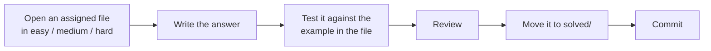

# Data Foundations

> One repository for the SQL, Python and data skills I practise and study, on the way to a Data Analyst or Analytics Engineer role. Every subject has two parts: **problem solving** and **learning**. New subjects are added as I learn them.

## Progress board

```text
SQL problems      ███░░░░░░░░░░░░░░░░░   5 of 33 solved   (15%)
Python problems   ██████░░░░░░░░░░░░░░   4 of 13 solved   (31%)
```

| Level | SQL waiting | SQL solved | Python waiting | Python solved |
| --- | ---: | ---: | ---: | ---: |
| Easy | 24 | 5 | 9 | 4 |
| Medium | 4 | 0 | 0 | 0 |
| Hard | 0 | 0 | 0 | 0 |

*Total = waiting + solved. The 12 LeetCode solutions in [`earlier-solutions/`](sql/problem-solving/earlier-solutions/README.md) are from before the daily routine and are not counted.*

## Daily loop



Commit messages look like `practice: solve question 10 not boring movies`.

## Study tracks

| Track | What is in the repo |
| --- | --- |
| **[SQL learning](sql/learning/README.md)** | A demo retail database (`nova_retail`, 9 tables) and 8 numbered stages: database setup, 21 topics (79 files), analytics, data cleaning, advanced SQL, data warehouse, ETL pipelines, performance |
| **[Python learning](python/learning/README.md)** | 5 notebooks (NumPy, pandas, a Pokémon pandas exercise, seaborn, plotly with cufflinks) and 2 exercises (Iris data analysis, salary analysis) |

## Roadmap

| Subject | Problem solving | Learning |
| --- | --- | --- |
| SQL | [In progress](sql/problem-solving/README.md) | [In the repo](sql/learning/README.md) |
| Python | [In progress](python/problem-solving/README.md) | [In the repo](python/learning/README.md) |
| Databases and data modelling | Planned | Planned |
| Git and Linux | Planned | Planned |
| Data structures and algorithms | Planned | Planned |
| MongoDB and NoSQL | Planned | Planned |

A planned subject gets its folder when the first work lands, so there are no empty folders here.

## Structure

```text
data-foundations/
├── sql/
│   ├── problem-solving/    easy, medium, hard, solved, earlier-solutions
│   └── learning/           00_database ... 07_performance, in study order
└── python/
    ├── problem-solving/    easy, medium, hard, solved
    └── learning/           notebooks and exercises
```

## Projects

Finished projects live in their own repositories.

| Project | What it found | Tools |
| --- | --- | --- |
| [Retail Sales & Profitability Analysis](https://github.com/dinesh-kumar-gudiputi/Sales-Performance-Profitability-Dashboard) | Order lines discounted over 30% lost $197k | SQL, Python, pandas, matplotlib |
| [Customer Churn & Retention Analysis](https://github.com/dinesh-kumar-gudiputi/Customer-Churn-Retention-analysis) | Month-to-month contracts are 55.1% of customers but 88.6% of churners | SQL, Python, pandas, matplotlib |
| [E-Commerce Sales Analysis](https://github.com/dinesh-kumar-gudiputi/Ecommerce-Sales-Analysis) | 392,692 of 541,909 rows kept after cleaning; the top 10% of customers bring 61.4% of revenue | Python, pandas, matplotlib |
| [Real-Time Sign Language Recognition](https://github.com/dinesh-kumar-gudiputi/project_AI-powerd-Realtime-communication-system-for-people-with-disabilites) | Webcam classifier for the letters A to I | Python, TensorFlow, Flask, OpenCV |
